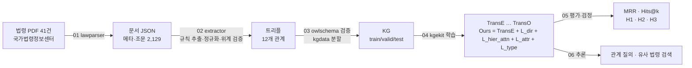
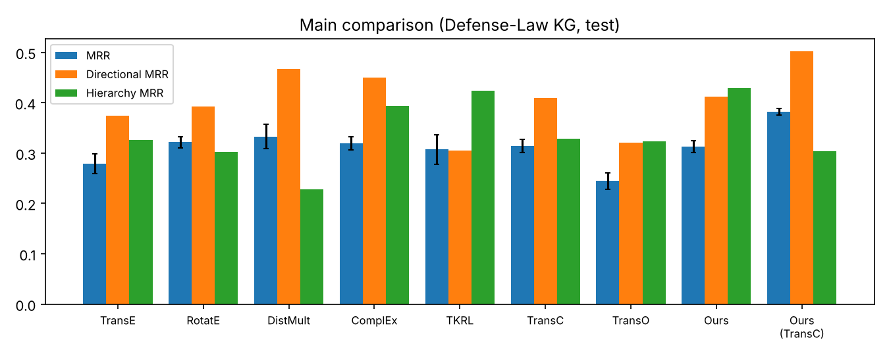

# thesis_final — Graph Embedding을 활용한 온톨로지 기반 의미 관계 검색 최적화

> **충북대학교 산업인공지능학과 석사 졸업논문 최종 통합 저장소**
> 송재익 (2025254013)
>
> 국방 법령 PDF 41건으로 한국어 지식그래프(KG)를 직접 구축하고, OWL Lite 온톨로지에서 유도한 **관계 방향성 제약(L_dir)** 과 **적응형 계층 가중(L_hier_attn)** 을 KGE 학습에 통합했습니다. PDF → KG → 학습 → 평가 → 추론까지 전 과정을 이 저장소 하나로 재현할 수 있습니다.

## 1. 연구 개요

| 항목 | 내용 |
|---|---|
| 문제 | 공공·국방 현장의 지식그래프는 수천 트리플 규모로 작고, 법령 인용·위임처럼 **방향이 중요한 관계**와 **법령 위계**가 핵심인데, 범용 KGE는 이를 구분하지 못함 |
| 접근 | 온톨로지(OWL Lite) 요소를 임베딩 학습의 보조 손실로 변환 |
| 데이터 | 직접 구축한 국방 법령 KG — 엔티티 2,352 · 관계 12 · 트리플 7,354 (v1.0) |
| 핵심 기여 | ① 방향성 제약 손실 L_dir ② 적응형 계층 가중 L_hier_attn ③ 한국어 국방 법령 KG 데이터셋 ④ GPU 없이 재현되는 NumPy 실험 엔진 |

### 연구 질문과 답

| RQ | 질문 | 답 (근거 저장소) |
|---|---|---|
| RQ1 | 한국어 공공 도메인 KG에 맞는 스키마와 구축 방법은? | OWL Lite 14클래스·11속성, 규칙 기반 추출 + 정규화 + 위계 검증 ([owl_lite_schema](https://github.com/Ikuuuu/owl_lite_schema), [law_triple_extraction](https://github.com/Ikuuuu/law_triple_extraction)) |
| RQ2 | 어떤 온톨로지 요소가 가장 영향이 큰가? | 기본 분할에서 전체 MRR엔 역관계(L_attr), 방향성 관계엔 L_dir, 계층 관계엔 L_hier_attn. 누수 없는 분할에서는 계층 관계 효과만 유지 ([ontology_constraint_kge](https://github.com/Ikuuuu/ontology_constraint_kge)) |
| RQ3 | 텍스트(한국어) 초기화는 도움이 되는가? | 문자 n-gram 초기화는 유의한 효과 없음 (p≈0.8). 텍스트는 검색 단계에서 결합할 때 효과적 ([korean_plm_init](https://github.com/Ikuuuu/korean_plm_init), [semantic_search_eval](https://github.com/Ikuuuu/semantic_search_eval)) |
| RQ4 | 데이터가 줄어도 강건한가? | 모든 비율에서 절대 성능 최고, H3 기준 충족 (여유는 작음) ([data_efficiency_analysis](https://github.com/Ikuuuu/data_efficiency_analysis)) |

## 2. 전체 파이프라인



손실 함수

```
L_total = L_struct + λ(t)·( α·L_type + β·L_hier_attn + γ·L_attr + δ·L_dir )

L_dir       = max(0, γ_dir + f(h,r,t) − f(t,r,h))           방향성 관계(인용·위임·소속 …)
L_hier_attn = 계층 관계별 평균 에너지의 softmax 로 학습 가중 재할당   상위법령·하위법령
L_attr      = tanh(f(h,r,t) − f(t,r⁻¹,h))                    owl:inverseOf
L_type      = ‖e − c_type(e)‖²                              rdf:type
```

## 3. 폴더 구조

```
thesis_final/
├── run_pipeline.py          # 전체 실행 진입점 (--quick / --data-only / --full / --report)
├── lawparser/               # ① PDF 파서
├── extractor/               # ② 트리플 추출 (rules, normalize, triples)
├── owlschema/               # ③ OWL Lite 스키마·검증
├── kgdata/                  # ③ 분할·통계
├── kgekit/                  # ④ NumPy KGE 엔진 (9개 모델, 4개 보조 손실, 평가, bootstrap)
├── scripts/01~06_*.py       # 단계별 실행 스크립트
├── ontology/schema.json
├── data/
│   ├── pdf/                 # 원본 법령 PDF 41건
│   ├── v1.0/                # 논문 실험에 쓴 고정 데이터셋
│   ├── v1.1/                # 개선 데이터셋 (파이프라인으로 재생성 가능)
│   └── eval/semantic_eval.json
├── checkpoints/demo_seed42/ # 추론 데모용 학습 파라미터 (TransE, Ours)
├── results/
│   ├── thesis_final_run2/   # 논문 본 실험 원자료 83런 + 요약(summary/) + 그림
│   └── demo_seed42/
└── tests/test_pipeline.py   # PDF→v1.0 재현, 학습 결정성 테스트
```

## 4. 실행 방법

```bash
python -m venv .venv && source .venv/bin/activate     # Windows: .venv\Scripts\activate
pip install -r requirements.txt

python run_pipeline.py --report      # 논문 원자료로 표·그림·가설 판정 재생성 (수 초)
python run_pipeline.py --quick       # PDF→KG(v1.1) 구축 + 5 epoch 스모크 실험 + 추론 (약 2분)
python run_pipeline.py --data-only   # PDF → KG v1.1 만
python run_pipeline.py --full        # 논문 전체 스펙 재실행: 83런 (CPU 약 1.5시간)

python -m pytest -q                  # 회귀 테스트
```

단계별로 실행할 때

```bash
python scripts/01_parse_pdfs.py                 # PDF → data/raw            (--legacy : 논문 v1.0 파서)
python scripts/02_extract_triples.py            # → data/interim/triples_v1.1.json
python scripts/03_build_dataset.py --version v1.1
python scripts/04_run_experiments.py --data data/v1.0 --out results/rerun
python scripts/05_report.py --run results/rerun
python scripts/06_inference.py --checkpoint checkpoints/demo_seed42/Ours_s42.npz \
       --head "방위사업법 시행령" --relation 상위법령
python scripts/06_inference.py --checkpoint checkpoints/demo_seed42/Ours_s42.npz --similar "군수품조달관리규정"
```

`--quick` 결과는 5 epoch만 학습한 동작 확인용이라 성능 수치에 의미가 없습니다.

## 5. 주요 결과 (국방 법령 KG v1.0, 5 seed 평균)



| 모델 | MRR | Hits@1 | Hits@10 | 방향성 MRR | 방향성 H@1 | 계층 MRR |
|---|---|---|---|---|---|---|
| TransE | 0.2787 | 0.1920 | 0.4248 | 0.3744 | 0.2674 | 0.3264 |
| RotatE | 0.3213 | 0.2533 | 0.4572 | 0.3921 | 0.3346 | 0.3024 |
| DistMult | 0.3329 | 0.2805 | 0.4258 | 0.4669 | 0.4041 | 0.2282 |
| ComplEx | 0.3190 | 0.2697 | 0.4060 | 0.4501 | 0.3904 | 0.3940 |
| TKRL | 0.3069 | 0.2060 | 0.5007 | 0.3053 | 0.2055 | 0.4231 |
| TransC | 0.3142 | 0.2086 | 0.4822 | 0.4093 | 0.3133 | 0.3279 |
| TransO | 0.2443 | 0.1479 | 0.4001 | 0.3210 | 0.2059 | 0.3237 |
| **Ours** | 0.3122 | 0.2070 | 0.4774 | 0.4126 | 0.2887 | **0.4289** |
| **Ours (TransC 기반)** | **0.3818** | **0.2803** | **0.5590** | **0.5015** | **0.4225** | 0.3038 |

| 가설 | 기준 | 결과 |
|---|---|---|
| H1 방향성 | 방향성 Hits@1 ≥ TransO + 5%p, p < 0.05 | ✅ +8.28%p, p < 0.001 |
| H2 계층 적응 | L_hier_attn 제거 시 계층 MRR ≥ 3%p 저하 | ✅ −5.70%p (계층 test 8개) |
| H3 강건성 | 50% 축소 시 ΔMRR(Ours) < 0.7·ΔMRR(TransE) | ✅ 0.1106 < 0.1145 |

`python scripts/05_report.py --run results/thesis_final_run2` 로 위 표와 판정을 원자료에서 그대로 다시 만들 수 있습니다.

## 6. 재현성

- **결정적 학습** : epoch마다 `RandomState(seed·9973 + epoch·7919 + 1)`로 난수를 고정해, 같은 seed면 결과가 비트 단위로 같습니다. 이번 정리에서 TransE · TransO · Ours · OursC를 다시 돌려 논문 기록과 같은 값을 확인했습니다.
- **데이터 재현** : `01_parse_pdfs.py --legacy` → `02_extract_triples.py --legacy` 결과가 논문 데이터셋(`data/v1.0`)의 트리플 집합과 정확히 같습니다 (`tests/test_pipeline.py`).
- **환경** : Python 3.10+, NumPy·SciPy·scikit-learn·matplotlib·pypdf·rdflib만 필요하고 GPU·PyTorch는 필요 없습니다.

## 7. 정리 과정에서 발견한 한계와 후속 과제

포트폴리오를 정리하면서 논문 결과를 다시 검증했고, 아래 사항을 발견해 각 저장소에 정리했습니다.

| # | 발견 | 영향 | 조치 / 후속 과제 |
|---|---|---|---|
| 1 | **파서 버그 3건** (조문 헤더 줄 누락, 가지조문 `제N조의M` 누락, 공포일) | v1.0 에서 조문 193개, 「」 인용 397건 누락 | v1.1 에서 수정 ([law_pdf_parser](https://github.com/Ikuuuu/law_pdf_parser)) |
| 2 | **표기 변이 중복 노드** 64군집, 법률 간 상호 위임 오추출 | 같은 법령이 여러 노드로 분산 | 정규화·위계 검증 (v1.1) |
| 3 | **역관계 누수** : test 트리플의 약 45%가 역관계를 train에 둠 | 누수 없는 분할에서는 MRR이 0.06~0.10으로 떨어지고 순위가 TransO > TransE > Ours로 뒤집힘. 방향성(H1) 우위도 사라짐. **계층 관계 우위(H2)만 유지** | 누수 없는 분할 `v1.1_noleak` 제공·재평가 ([defense_law_kg_dataset](https://github.com/Ikuuuu/defense_law_kg_dataset)). 누수 없는 valid로 하이퍼파라미터 재탐색 필요 |
| 4 | Ours 는 50 epoch 가 150 epoch 보다 test MRR 이 높음 | 고정 150 epoch 는 과학습 가능성 | valid 기준 early stopping 재실험 필요 |
| 5 | 계층 관계 test 트리플 8개 | H2 표본이 작음 | 계층 관계가 많은 도메인으로 확장 |
| 6 | 코사인 유사도 검색에서는 Ours < TransE | 링크 예측 향상 ≠ 유사도 검색 향상 | 관계 지정 질의 또는 텍스트 하이브리드 사용 |

## 8. 저장소 지도 (2026학년도 2학기 포트폴리오)

| # | 저장소 | 논문 위치 |
|---|---|---|
| 11 | [kge_baseline_benchmark](https://github.com/Ikuuuu/kge_baseline_benchmark) | 베이스라인 7종 비교 |
| 12 | [law_pdf_parser](https://github.com/Ikuuuu/law_pdf_parser) | Part 1 · PDF 파싱 |
| 13 | [owl_lite_schema](https://github.com/Ikuuuu/owl_lite_schema) | Part 1 · 온톨로지 (RQ1) |
| 14 | [law_triple_extraction](https://github.com/Ikuuuu/law_triple_extraction) | Part 1 · 트리플 추출 (RQ1) |
| 15 | [defense_law_kg_dataset](https://github.com/Ikuuuu/defense_law_kg_dataset) | Part 1 · 데이터셋 |
| 16 | [ontology_constraint_kge](https://github.com/Ikuuuu/ontology_constraint_kge) | Part 2 · 방법론 (RQ2, H1, H2) |
| 17 | [korean_plm_init](https://github.com/Ikuuuu/korean_plm_init) | Part 2 · 텍스트 초기화 (RQ3) |
| 18 | [data_efficiency_analysis](https://github.com/Ikuuuu/data_efficiency_analysis) | Part 3 · 데이터 효율성 (RQ4, H3) |
| 19 | [semantic_search_eval](https://github.com/Ikuuuu/semantic_search_eval) | Part 3 · 의미 검색 |
| 20 | **thesis_final** (현재) | 전체 통합 |

지난 학기 [capstone_final](https://github.com/Ikuuuu/capstone_final)(지능화캡스톤 최종 실험구현)과 비교하면 다음이 달라졌습니다.

- 베이스라인 2종(TKRL, TransC)과 **Ours(TransC 기반)** 추가 → 손실의 베이스 독립성 확인
- 파이프라인을 패키지 단위(lawparser · extractor · owlschema · kgdata · kgekit)로 재구성하고 `run_pipeline.py` 한 줄 실행 지원
- 데이터셋 v1.1 (파서 버그 수정 · 정규화 · 위계 검증), 스키마 기반 검증기, 추론 데모, 회귀 테스트 추가
- 재검증으로 찾은 한계(역관계 누수, 과학습 가능성 등)를 정리하고 후속 실험 근거 마련

---
송재익 · 충북대학교 산업인공지능학과 석사과정 (2025254013) · INDAI 콜로키움 2026 투고 논문 기반
